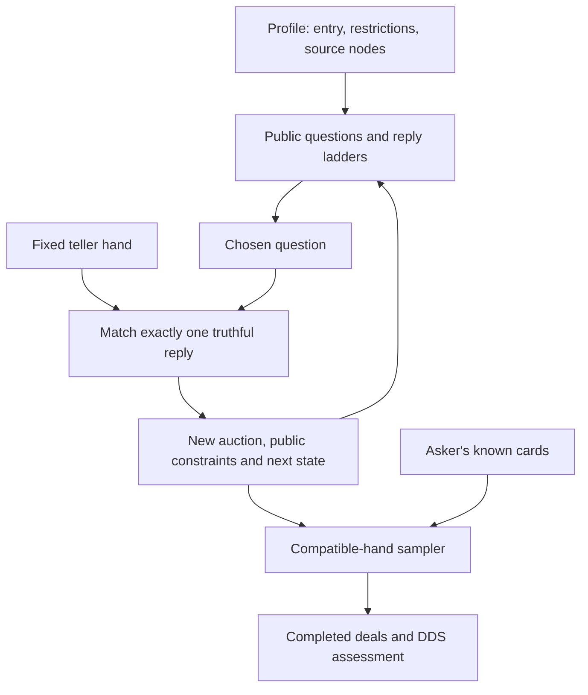

# How the relay bid trees work

[System tables](README.md) · [Maintenance](../relay-maintenance.md) ·
[Source consistency audit, 22 October 2026](audit-2026-10-22.md)

## What kind of bidder this is

The relay trainer is a deterministic interpreter for source-backed bidding
agreements. Its 63 exercises are assembled from family templates, small shape
sets and shared continuations. It does not search every possible auction or
every possible deal to decide partner's reply. It also does not yet choose an
optimal opening bid or contract from an unrestricted hand.

There are three different jobs, with different algorithms:

| Job | Implementation |
|---|---|
| Answer a relay | Match the fixed teller hand against a short list of response predicates |
| Describe what partner could hold | Accumulate public constraints, then sample compatible hands combinatorially |
| Assess a proposed contract | Complete sampled deals and call the separate DDS card-play solver |

DDS search is not used to invent bidding meanings. No language model interprets
the notes while a user is bidding.

## From source notes to a reusable graph

Definitions live in [the registry](../../website/relay/profiles.js),
[major rules](../../website/relay/system.js), and the minor, club, strong-club,
split-range, Horton and reordered-rebid profile modules. A profile specifies:

- The complete entry auction, asking/telling seats and source references.
- The public hand universe admitted to that exercise, including training limits.
- A start node and named continuation nodes.
- Asking calls, reply predicates, disclosed facts and the next node or phase.
- Trump agreements, reserved asking calls, playable contracts and exclusions.

Most profiles are instances of parameterized constructors. For example,
`singleProfile` in [rebid-profiles.js](../../website/relay/rebid-profiles.js)
handles different opened suits, response suits and three-card-support variants.
`createHortonProfile` builds the three Horton entries from the same rules.
The two major exercises retain a separate shape/range handler in
[core.js](../../website/relay/core.js), then join the shared slam routines.
This is a partial common architecture, not a fully unified bidding language.

Whole-auction practice uses separate short state graphs for opening choices.
The [passed-hand module](../../website/relay/passed-hand.js) handles the
uncontested third/fourth-seat agreements; source rows become actions with
predicates and next nodes, sharing the controller, persistence and UI with
ordinary openings. Its partner policy receives only that player's hand and
public node/auction data. Initial two-hand generation uses seeded bounded
rejection; response selection does not search hands or auctions. See the
[passed-hand implementation and limits](passed-hand.md).

The graph has both literal source tables and computed transitions. Where notes
give explicit calls, a response stores its `bid`. Where notes give only a stack,
the interpreter assigns consecutive bids. Dynamic nodes are functions of public
state: they can relocate the next enquiry, offer another trump agreement or
remove publicly impossible categories without copying an entire auction tree.

An example is `1D–1S–2C–2H`. The July email's explicit E5 rows become:

| Reply | Predicate/meaning in the exercise |
|---|---|
| 2S | Poor-opening screen: 9–10 HCP under the disclosed practice policy |
| 2NT | Ordinary diamond/club two-suiter, spade shortage |
| 3C | Ordinary diamond/club two-suiter, heart shortage |
| 3D | 1444 or 0454 |
| 3H | 5/5 minors, spade shortage |
| 3S | 5/5 minors, heart shortage |
| 3NT | 3154, 16+ |

These are shape predicates and strength constraints, not a list of every hand
that can give each answer. The entry admits ordinary 11-counts; the special
support shape retains its 16+ threshold. Applicable 6/5 hands are currently
excluded rather than assigned invented extra replies.

## One immutable transition at a time

For non-major profiles, `practiceNode`, `prepareFamilyAction` and
`applyFamilyBid` in [core.js](../../website/relay/core.js) perform the transition:

1. Resolve the current node using public auction state.
2. Construct its actions and reply ladders. Add permitted final contracts.
3. Validate the selected call and any explicit asker-hand prerequisite.
4. Match the original teller hand against the response constraints.
5. Require **exactly one** matching family-table reply; throw on zero or overlap.
6. Append the question, answer and newly disclosed constraints; advance the
   node/phase and freeze the new state.

Shared keycard/queen/suit routines classify the fixed hand directly rather
than repeating the family-table matcher. Both paths retain the original hand.
Undo can therefore restore a previous state without generating a new partner.
The engine cannot quietly change partner's cards to rescue a definition error.

Baron minor agreements can explicitly hand the enquiry to the other player.
This changes which fixed hand is represented by `playerHand` (asker) and
`partnerHand` (teller), preserving both hands at their original seats. Public
constraints switch to the newly describing hand; undo retains the earlier
roles. The separate seat-view adapter rotates the whole displayed partnership
so the human always appears South, including study, assessment and saved review.

The exactly-one check is valuable but limited: a wrong table can still divide
its admitted hands perfectly. Excluding a normal hand from the initial universe
also prevents that hand from ever exposing a missing response. Source audits
and independently authored expected auctions remain necessary.

## Information tracking and safe compression

`matchesConstraints` understands HCP, ace/king controls, suit lengths, exact SHDC
shapes, balanced/no-shortage facts, specific honours, keycard alternatives,
trump queen and specific-suit response categories. Facts accumulate as a
conjunction. `anyOf` represents a union of complete conjunctions, preserving
relationships such as **this shape at this strength OR that shape at a different
strength**. Flattening those branches into independent suit bounds would admit
hands that were never described.

Dynamic family nodes receive `publicSession(session)`, with both actual hands
removed. Public length inference in
[continuations.js](../../website/relay/continuations.js) intersects the disclosed
length/shape alternatives with the 13-card total. It considers only **560**
possible nonnegative SHDC length vectors. Family shape helpers in
[source-utils.js](../../website/relay/source-utils.js) use **480** vectors capped
at nine cards in a suit. These are small finite classifications, not an
enumeration of card holdings.

Specific-suit answer compression uses those public length implications, not
the actual teller hand or the asker's cards. A suit publicly known to contain
four cards cannot reply Kx. A public doubleton permits third-round control, Kx
and KQ; it cannot reply no third-round control or Kxx+. The inference is
deliberately conservative about honour/strength facts: it is not a general
constraint solver proving every possible deduction.

## Shared continuations and bid arithmetic

[continuations.js](../../website/relay/continuations.js) implements ordinary
keycard, void-first Shortage Keycard, Horton's 0/1/2 scheme, queen enquiries,
specific-suit enquiries and the reordered single-suit strength escapes.
After a source node establishes a shape and agreement, it normally hands off
to this shared phase machine.

Bids have an ordered integer index over `C, D, H, S, NT` at levels 1–7. Asking
reservations and answer counting are separate operations:

- A branch can reserve asker 3NT for play or skip a major game as an enquiry.
- Ordinary answer ladders count consecutive calls, including a call the asker
  would skip. A source-specific answer reservation needs an explicit ladder.
- After keycard, trump calls below game remain available for enquiries in the
  clarified game-forcing auctions. The game/slam trump calls and the call just
  below six of trumps are reserved by the specific-suit asking routine.
- Reordered single-suit profiles can split an answer that lands on playable
  game into lower strength at game and upper strength at the first otherwise
  impossible answer. This is separate from the ordinary keycard alphabet.

Thus the clarified diamond auction ending `…3S–4C` can offer **4D** as the
queen ask, with 4H/4S replies. A blanket rule skipping every diamond call would
be wrong. Conversely, the explicit P0425 instruction to bypass **answer** 3NT
cannot be implemented merely by setting `skip3NT` on asking calls. The audit
found one existing violation of that distinction.

## Compatible hands without enumerating billions of deals

With the asker's 13 cards known, partner has `C(39,13) = 8,122,425,444` possible
card holdings before auction restrictions. `sampleCompatible` does not walk
that list. It:

1. Removes the known cards and derives feasible suit-length vectors.
2. Weights each vector by `C(nS,s) × C(nH,h) × C(nD,d) × C(nC,c)`, where `nX`
   is the number of remaining cards in that suit.
3. Draws a vector from cumulative weights, then draws cards uniformly within
   each suit using partial Fisher–Yates.
4. Rejects proposals failing the remaining HCP, controls, honour, keycard or
   other public predicates. Stops at a disclosed attempt limit if necessary.

For a vector with weight W, choosing it contributes W/total and choosing its
particular holding contributes 1/W. Every proposed holding therefore has the
same probability, and rejection preserves uniformity among accepted holdings,
under the pseudorandom model. Sampling is with replacement; repeats are valid.
The hidden original partner hand is not an input to compatible-hand sampling.

There **is bounded rejection**, particularly for rare late honour constraints.
This is not an optimized honour-conditioned generator. Practice deal generation
uses a similar shape-conditioned proposal and rejects an entire pair if either
hand fails the profile's remaining restrictions. It has a one-million-attempt
limit. Major entry generation uses its earlier separate draw-and-filter path.

For assessment, [evaluation.js](../../website/relay/evaluation.js) completes
East/West layouts and compares contracts on common complete deals with DDS.
Artificial bids count toward the first bidder of a strain when determining
declarer. Revealed-partnership assessment fixes both actual hands and varies
opponents; auction-compatible assessment varies partner too. These estimate DD
results, not the expected value of the next relay decision or human play.

## Practice automation and engineering limits

[practice.js](../../website/relay/practice.js) adapts the same source system for
asker or teller practice. In teller mode it selects a public question in source
order, applying only explicit prerequisites from the asker's own cards. It does
not inspect teller's hand to select a useful question and does not optimize the
eventual contract. A wrong teller response leaves the committed state unchanged.

After keycard, [slam-policy.js](../../website/relay/slam-policy.js) applies
Josh's 17 November rule: fewer than 4½ keycards stops in game; 4½ or five bids
six; only all five plus the queen permits grand investigation. Unknown queen
answers are sought when useful. All side-suit enquiries beyond the queen ask
are grand tries, not ordinary slam investigation.

The policy projects public constraints onto at most **64 honour patterns**
(five keycards plus the queen), excluding the asker's own cards and impossible
HCP/control bounds. It does not enumerate 13-card holdings or inspect partner's
actual hand. Unresolved alternatives use the least favourable compatible total.
Only a guaranteed 5½ enters side-suit grand tries. Known third-round controls
in either hand can skip a question; a negative answer stops at six. Seven is
chosen once the needed side controls are accounted for. This remains a
conservative bidding policy, not a proof of thirteen tricks or a DDS search.

The current design is economical and inspectable, with some remaining debt:

| Limit | Useful next improvement |
|---|---|
| Major handler differs from the other families; bid stepping is implemented in several helpers | Consolidate semantics while retaining explicit source exceptions |
| Training filters can hide missing source branches | Track source coverage separately from executable reachability |
| `threeNTToPlay` can be absent, and generic contract generation then permits Pass | Model forcing/playable meaning explicitly at each relevant reply |
| Source IDs are mostly strings/comments; original documents are not executable | Add independent source-example fixtures and an explicit decision ledger |
| Saved-session version identifies format, not the bidding-rule revision | Invalidate or replay snapshots when their source rules change |
| Narrow late honour restrictions can exhaust rejection attempts | Add conditioned honour generation if measurements justify it |

These limitations, including two reproduced inconsistencies, are detailed in
the [dated audit](audit-2026-10-22.md). Passing the interpreter tests establishes
behaviour within its definitions, not completeness or partnership approval of
the entire bidding system.
